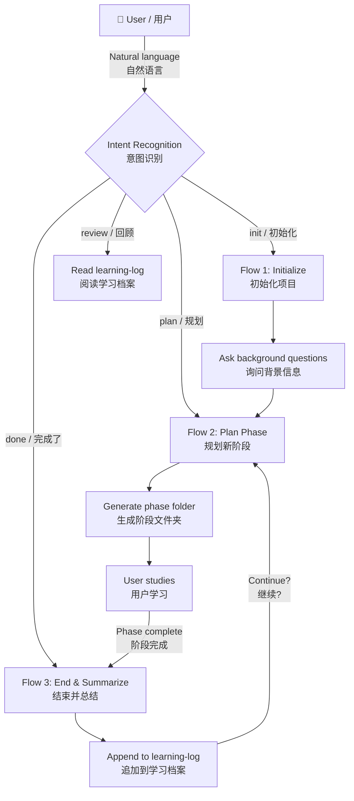
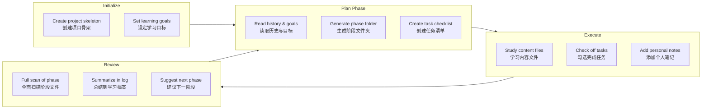

# Learning Planner / 学习规划器

A Claude Code plugin that acts as your long-running learning companion — helps you **plan**, **track**, and **review** self-directed learning in structured phases.

一个 Claude Code 插件，作为你的长期学习伙伴 —— 帮助你按结构化阶段**规划、追踪、回顾**自主学习。

---

## English

### Interaction Flow / 交互流程



### Phase Lifecycle / 阶段生命周期



### Features

- **Phase-based learning** — Break ambitious goals into manageable phases, each with its own folder, task list, and content files
- **Natural language interaction** — Just talk to Claude Code normally; the skill recognizes intent in both English and Chinese
- **Obsidian-compatible** — All generated files use `- [ ]` / `- [x]` checkboxes, `[[wikilinks]]`, and LaTeX math (`$...$` / `$$...$$`)
- **Token-efficient context** — Uses a compressed `learning-log.md` for history so planning stays fast across many phases

### Three Core Workflows

| Flow | Trigger Examples | What It Does |
|------|-----------------|--------------|
| **Initialize** | "setup learning project", "帮我建立学习档案" | Creates the project skeleton with goals, log, and CLAUDE.md rules |
| **Plan Phase** | "plan my study", "帮我规划学习", "what should I learn next" | Reads your history and goals, generates a phase folder with task checklist and content files |
| **End & Summarize** | "I finished this phase", "我学完了", "阶段结束" | Scans everything in the phase folder, appends summary to learning log, suggests next steps |

### Installation

```bash
claude plugin install learning-planner@claude-plugins-official
```

Or browse in Claude Code: `/plugin > Discover`

### Usage

Once installed, just talk to Claude Code naturally. The skill recognizes intent from your everyday language:

```
"帮我规划下一个学习阶段"
"I just finished the machine learning phase, can you summarize it?"
"初始化一个学习项目"
"What should I focus on next?"
```

### Project Structure Created by the Skill

```
<your-learning-project>/
├── CLAUDE.md                   # Project rules for Claude Code
├── learning-goals.md            # Your long-term & short-term goals
├── learning-log.md              # Cumulative phase summaries
│
├── YYYYMMDD-<topic>/            # One folder per learning phase
│   ├── phase-plan.md            # Phase overview + checkbox task list
│   ├── 01_<item>.md             # Learning content files
│   ├── 02_<item>.md
│   └── ...
│
└── YYYYMMDD-<topic>/
    └── ...
```

### No Preset Curriculum

This plugin does **not** come with any pre-loaded learning content. It adapts to *your* goals — whether you're studying protein engineering, learning Japanese, preparing for a coding interview, or mastering the piano. You define the direction during initialization, and the skill helps you break it down and stay on track.

### Language Support

All prompts and responses work in both **English** and **Chinese** (中文). Phase folders and content files can use any language.

---

## 中文

### 功能特点

- **分阶段学习** — 把宏大目标拆解为可管理的阶段，每个阶段有独立文件夹、任务清单和学习内容
- **自然语言交互** — 像平时聊天一样对 Claude Code 说话，skill 自动识别中英文意图
- **Obsidian 兼容** — 所有生成文件使用 `- [ ]` / `- [x]` 勾选框、`[[wikilinks]]` 和 LaTeX 数学公式
- **Token 高效** — 通过精简的 `learning-log.md` 保存历史摘要，多次迭代后规划依然快速

### 三个核心工作流

| 工作流 | 触发示例 | 功能 |
|--------|---------|------|
| **初始化项目** | "帮我建立学习档案", "setup learning project" | 创建项目骨架：目标文件、学习档案、CLAUDE.md 规则 |
| **规划新阶段** | "帮我规划学习", "what should I learn next" | 读取历史与目标，生成阶段文件夹、任务清单、学习内容文件 |
| **结束并总结** | "我学完了", "阶段结束", "I finished this phase" | 全面扫描阶段文件夹，追加摘要到学习档案，建议后续方向 |

### 安装

```bash
claude plugin install learning-planner@claude-plugins-official
```

或在 Claude Code 中通过 `/plugin > Discover` 浏览安装。

### 使用方式

安装后直接自然对话即可，无需记命令：

```
"帮我规划下一个学习阶段"
"这个阶段终于啃完了，帮我总结一下"
"回顾一下我的学习进度"
"接下来学什么好"
```

### 生成的项目结构

```
<你的学习项目目录>/
├── CLAUDE.md                   # Claude Code 项目规则
├── learning-goals.md            # 你的长/短期学习目标
├── learning-log.md              # 各阶段累计摘要
│
├── YYYYMMDD-<主题>/              # 每个学习阶段一个文件夹
│   ├── phase-plan.md            # 阶段计划 + 勾选框任务清单
│   ├── 01_<内容>.md             # 学习内容文件
│   ├── 02_<内容>.md
│   └── ...
│
└── YYYYMMDD-<主题>/
    └── ...
```

### 不预设任何学习内容

本插件**不包含**任何预设的课程或学习材料。它会适应你自己的目标 —— 无论是蛋白质工程、日语学习、编程面试还是钢琴练习。你在初始化时定义方向，skill 帮你拆解、追踪、坚持。

### 语言支持

所有提示和回复均支持**英文和中文**。阶段文件夹名和内容文件可使用任何语言。

---

## License

MIT
